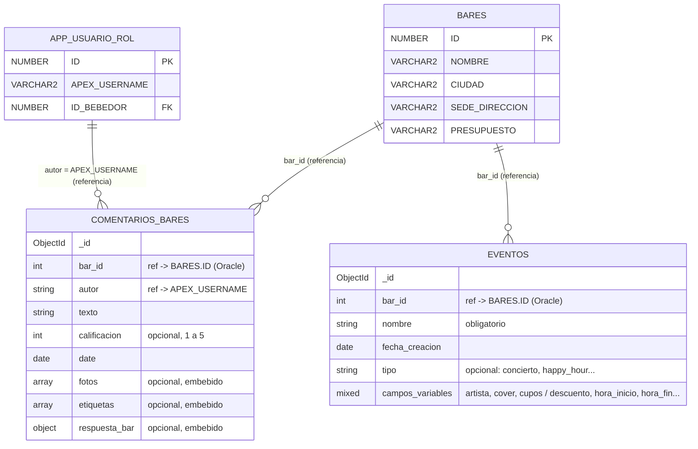

# Taller 3 – Parte 1: Modelado de datos (DrinkAdvisor NoSQL)

## Arquitectura de datos

DrinkAdvisor queda con **dos bases de datos**:

- **Oracle (relacional):** sigue siendo la fuente de verdad de `BARES`, `BEBIDAS`, `TIPOS_BEBIDA`, `BEBEDORES`, `SIRVEN`, `GUSTAN`, `VISITAS`, `BEBIDAS_VISITA` y `APP_USUARIO_ROL`.
- **MongoDB (documental):** guarda solo lo que tiene estructura variable, en dos colecciones: `comentarios_bares` y `eventos`.

Las dos bases se enlazan por identificadores. `bar_id` en Mongo es el `BARES.ID` de Oracle, y `autor` es el `APEX_USERNAME` del usuario que escribe.

## Diagrama



Leyenda: las líneas entre Oracle y Mongo son **referencias** (se guarda el id, no una copia del dato). Los campos marcados como "embebido" viven **dentro** del documento.

### Ejemplos de documentos

Comentario (`comentarios_bares`):

```json
{
  "_id": ObjectId("..."),
  "bar_id": 1,
  "autor": "LJ.SANCHEZC1@UNIANDES.EDU.CO",
  "texto": "Muy buena música y atención rápida",
  "calificacion": 5,
  "date": ISODate("2026-11-23T20:15:00Z"),
  "etiquetas": ["música", "servicio"]
}
```

Evento tipo concierto (`eventos`):

```json
{ "bar_id": 2, "nombre": "Noche de Jazz", "artista": "Trío Bogotá", "cover": 15000, "cupos": 80,
  "fecha_creacion": ISODate("2026-11-23T20:20:00Z") }
```

Evento tipo happy hour, con otra estructura en la misma colección (`eventos`):

```json
{ "bar_id": 2, "nombre": "Happy Hour Martes", "descuento": "2x1 en cervezas",
  "hora_inicio": "17:00", "hora_fin": "19:00", "fecha_creacion": ISODate("2026-11-23T20:25:00Z") }
```

## Pregunta 1 (10 pts)

**¿Qué estrategia se utilizó para modelar cada entidad de DrinkAdvisor dentro de la base de datos documental? ¿Cuáles relaciones se modelaron como objetos embebidos y cuáles como referencias?**

Las entidades que ya existían (bares, bebidas, tipos de bebida, bebedores, visitas) **no se copiaron a MongoDB**. Siguen en Oracle porque su estructura es fija, tienen integridad referencial (PK/FK, CHECK) y la aplicación las consulta con SQL y joins. Duplicarlas en Mongo obligaría a mantener dos copias sincronizadas, sin ganar nada.

Desde MongoDB, esas entidades se usan solo **por referencia**:

| Relación | Estrategia | Por qué |
|---|---|---|
| Bar → comentarios | **Referencia** (`bar_id` en cada comentario) | Un bar puede tener muchísimos comentarios (relación uno a muchos sin límite). Embeberlos en el bar haría crecer el documento sin tope (límite de 16 MB) y el bar además vive en Oracle. |
| Bar → eventos | **Referencia** (`bar_id` en cada evento) | Mismo caso: uno a muchos que crece con el tiempo. Los eventos se consultan por bar (`find({bar_id})`), lo que se resuelve con un índice sobre `bar_id`. |
| Bebedor/usuario → comentario | **Referencia** (`autor` = username de APEX) | El usuario ya existe en Oracle/APEX. Solo hace falta saber quién escribió, no copiar sus datos (que podrían cambiar). |

Se usa **referencia del hijo al padre** (el comentario/evento apunta al bar), que es el patrón recomendado para relaciones uno a muchos grandes.

## Pregunta 2 (10 pts)

> Nota: en el enunciado, las preguntas 1 y 2 tienen el mismo texto. Aquí la 2 se responde sobre las **entidades nuevas** que se crean en MongoDB (comentarios y eventos). La 1 se respondió sobre las entidades existentes de DrinkAdvisor.

**Comentarios (`comentarios_bares`):**
- Cada comentario es **un documento independiente** en su propia colección.
- **Embebido:** todo lo que pertenece solo a ese comentario y no tiene sentido fuera de él: texto, calificación opcional, fecha, y campos variables como fotos, etiquetas o una respuesta del bar. Se leen siempre junto con el comentario, son pocos y acotados, así que embeberlos evita consultas extra.
- **Referenciado:** el bar (`bar_id`) y el autor (`autor`), por las razones de la tabla anterior.
- La estructura puede variar: un comentario puede traer `calificacion` y otro no, o traer campos extra. MongoDB lo permite sin cambiar ningún esquema, y ese es justamente el requerimiento del negocio.

**Eventos (`eventos`):**
- Se usa el **patrón polimórfico**: todos los tipos de evento van en **una sola colección**, con unos campos comunes (`bar_id`, `nombre`, `fecha_creacion`) y campos propios de cada tipo (concierto: `artista`, `cover`, `cupos`; happy hour: `descuento`, `hora_inicio`, `hora_fin`).
- **Embebido:** los atributos del evento, incluidos los específicos de su tipo, porque describen solo ese evento.
- **Referenciado:** el bar (`bar_id`).
- Así se consultan todos los eventos de un bar con un solo `find({bar_id})`, sin importar su tipo, y se pueden agregar tipos nuevos sin modificar nada. El formulario de APEX envía únicamente los campos que el usuario llenó.
